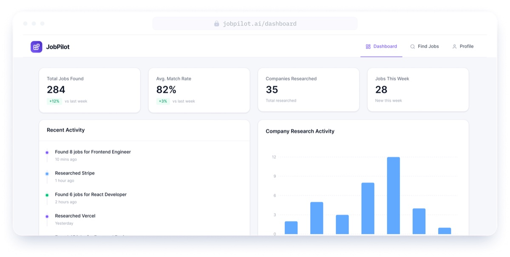

<div align="center">

# JobPilot

**AI-Powered Job Hunting Assistant**

Set up your profile once. JobPilot discovers relevant jobs, scores them against your skills, researches each company, and prepares interview materials — so you just decide which ones to apply to.

[](https://nextjs.org/)
[](https://www.typescriptlang.org/)
[](https://tailwindcss.com/)
[](LICENSE)

</div>

---

## Overview

Job hunting is repetitive — reading dozens of job descriptions, deciding if a role fits, researching each company from scratch. JobPilot eliminates that preparation work.

The agent finds jobs via Adzuna, scores each one against your actual skills using Gemini, researches companies across their public web pages with browser automation, and generates interview prep materials and application email templates. You review everything and apply with one click.

## Features

- **AI Job Matching** — Gemini scores each job 0–100 against your profile, with matched/missing skills breakdown
- **Company Research Agent** — Automated browser research (Playwright + Stagehand) builds structured dossiers: tech stack, culture, why the role exists, interview prep
- **Interview Prep** — STAR-format behavioral questions, technical questions, talking points, and closing strategies
- **Email Templates** — Networking outreach, follow-up, and thank-you emails with copy-to-clipboard
- **Resume Management** — Upload existing resume with AI extraction, or generate a professional PDF from your profile
- **Application Tracker** — Track job statuses (Saved → Applied → Interviewing → Rejected) across your pipeline
- **Dashboard Analytics** — Stats, recent activity, match score distribution, skills gap analysis
- **Dark Mode** — System-aware theme with manual toggle

## Screenshots

<div align="center">



</div>

## Tech Stack

| Layer | Technology |
|---|---|
| Framework | [Next.js 16](https://nextjs.org/) (App Router) |
| Backend | [InsForge](https://insforge.app/) — Auth, Database, Storage |
| AI Model | [Google Gemini 2.5 Flash](https://ai.google.dev/) |
| Job Discovery | [Adzuna API](https://developer.adzuna.com/) |
| Browser Automation | [Playwright](https://playwright.dev/) + [Stagehand](https://stagehand.dev/) |
| Styling | [Tailwind CSS 4](https://tailwindcss.com/) + [shadcn/ui](https://ui.shadcn.com/) |
| Charts | [Recharts](https://recharts.org/) |
| PDF Generation | [@react-pdf/renderer](https://react-pdf.org/) |
| Analytics | [PostHog](https://posthog.com/) |

## Getting Started

### Prerequisites

- Node.js 18+
- An [InsForge](https://insforge.app/) project (provides auth, database, and storage)
- A [Google Gemini API key](https://ai.google.dev/)
- An [Adzuna API key](https://developer.adzuna.com/)
- A [PostHog](https://posthog.com/) project (optional, for analytics)

### Installation

```bash
git clone https://github.com/UzairJIqbal/Job_Pilot.git
cd Job_Pilot
npm install
```

### Environment Variables

Create a `.env.local` file:

```env
# InsForge
NEXT_PUBLIC_INSFORGE_URL=https://your-app.insforge.app
NEXT_PUBLIC_INSFORGE_ANON_KEY=your-anon-key

# Gemini
GEMINI_API_KEY=your-gemini-key

# Adzuna
ADZUNA_APP_KEY=your-app-id
ADZUNA_API_KEY=your-app-key

# PostHog (optional)
NEXT_PUBLIC_POSTHOG_KEY=your-posthog-key
NEXT_PUBLIC_POSTHOG_HOST=https://app.posthog.com
```

### Database Setup

Run these SQL statements against your InsForge database:

```sql
-- Jobs table
CREATE TABLE jobs (
  id uuid DEFAULT gen_random_uuid() PRIMARY KEY,
  run_id uuid REFERENCES agent_runs(id),
  user_id uuid REFERENCES profiles(id),
  source text CHECK (source IN ('search', 'url')),
  source_url text,
  external_apply_url text,
  title text NOT NULL,
  company text,
  location text,
  salary text,
  job_type text,
  about_role text,
  responsibilities text[],
  requirements text[],
  nice_to_have text[],
  benefits text[],
  about_company text,
  match_score integer,
  match_reason text,
  matched_skills text[],
  missing_skills text[],
  company_research jsonb,
  interview_prep jsonb,
  email_templates jsonb,
  status text DEFAULT 'saved' CHECK (status IN ('saved', 'applied', 'interviewing', 'rejected')),
  found_at timestamptz DEFAULT now()
);

-- Agent runs
CREATE TABLE agent_runs (
  id uuid DEFAULT gen_random_uuid() PRIMARY KEY,
  user_id uuid REFERENCES profiles(id),
  status text CHECK (status IN ('running', 'completed', 'failed')),
  job_title_searched text,
  location_searched text,
  jobs_found integer,
  started_at timestamptz DEFAULT now(),
  completed_at timestamptz
);

-- Agent logs
CREATE TABLE agent_logs (
  id uuid DEFAULT gen_random_uuid() PRIMARY KEY,
  run_id uuid REFERENCES agent_runs(id),
  user_id uuid REFERENCES profiles(id),
  message text,
  level text CHECK (level IN ('info', 'success', 'warning', 'error')),
  job_id uuid,
  created_at timestamptz DEFAULT now()
);

-- Storage bucket for resumes
INSERT INTO storage.buckets (id, name, public) VALUES ('resumes', 'resumes', false);
```

> **Note:** The full schema with RLS policies is managed through InsForge. The above covers the core tables.

### Run

```bash
npm run dev
```

Open [http://localhost:3000](http://localhost:3000).

## Project Structure

```
/
├── app/                    # Pages and API routes
│   ├── (auth)/             # Login + OAuth callback
│   ├── dashboard/          # Overview, stats, analytics
│   ├── find-jobs/          # Search + job listings
│   │   └── [id]/           # Individual job details
│   ├── profile/            # Profile form + resume management
│   └── api/agent/          # Agent API routes
├── agent/                  # AI agent logic
│   ├── adzuna.ts           # Job discovery + scoring
│   ├── research.ts         # Company research (Playwright)
│   ├── interview-prep.ts   # Interview materials
│   └── email-templates.ts  # Application emails
├── actions/                # Server Actions
├── components/             # UI components
├── lib/                    # Clients + utilities
└── types/                  # Shared TypeScript types
```

## How It Works

1. **Sign up** with Google or GitHub OAuth
2. **Complete your profile** — skills, experience, preferences (or let AI extract from your resume)
3. **Search for jobs** — enter title + location, agent discovers and scores matches
4. **Research companies** — one-click browser research builds a structured dossier
5. **Prepare for interviews** — AI generates STAR questions, technical prep, and email templates
6. **Apply** — click through to the company's application page

## License

MIT
